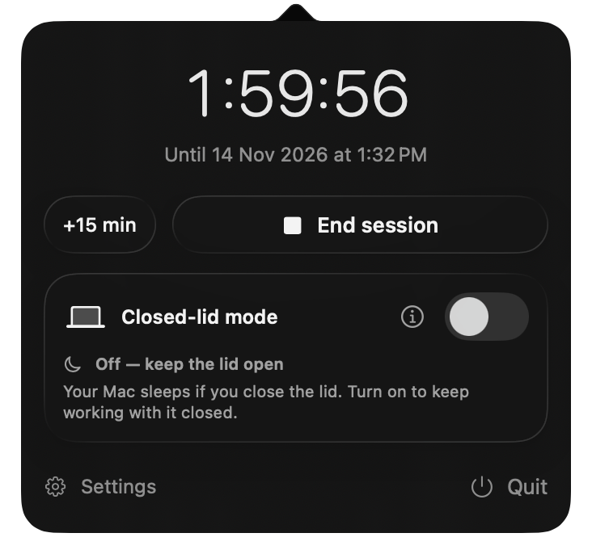

# pritesh-lab

My personal setup for working with AI coding agents (mostly Claude Code) on a Mac: the hooks, scripts, small apps and experiments that make long agent sessions easier to run, watch and come back to.

Everything here is something I actually use day to day. Each folder is self-contained, with its own README, and anything personal (logos, local config, machine-specific settings) stays out of git.

## What's inside

### See what the agent sees: [cmux image preview](hooks/cmux-image-preview/)

When Claude takes a screenshot, generates an image or opens one, it appears in a split right next to the conversation, so there's no hunting through folders for the PNG.

### Keep the Mac awake while agents work: [Vigil](experiments/vigil/)

A menu-bar app and `vigil` CLI that keep the machine awake for a set time, even with the lid closed and even if the app quits. Safety limits for battery, heat and time are enforced by a background helper.



### Find projects at a glance: [Desktop folder icons](scripts/desktop-folder-icons/)

Pastel folder icons with each project's logo or an SF Symbol, plus a fixed Desktop layout grouped into zones. Purely cosmetic: nothing moves on disk.


## Layout

```
agents/        custom subagents: code-reviewer, researcher, debugger
skills/        Claude Code skills: development, research, productivity
hooks/         Claude Code hooks
  cmux-image-preview/     images from Claude in a cmux split
  post-tool-use/
scripts/       standalone helper scripts
  desktop-folder-icons/   themed Finder icons + Desktop layout
workflows/     multi-step workflows
experiments/   bigger projects and things being tried out
  vigil/                  keep-awake menu-bar app + CLI
```

Empty folders are placeholders for what's coming next.

## Requirements

macOS. Most pieces assume [Claude Code](https://claude.com/claude-code); the image preview also needs the [cmux](https://github.com/manaflow-ai/cmux) terminal. Each folder's README lists anything else it needs.
