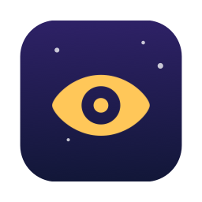
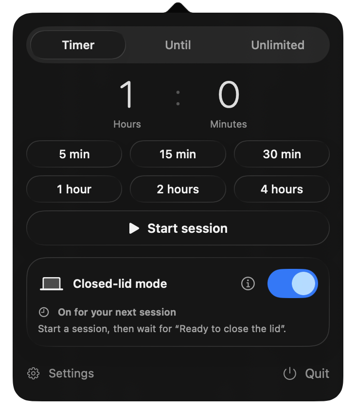
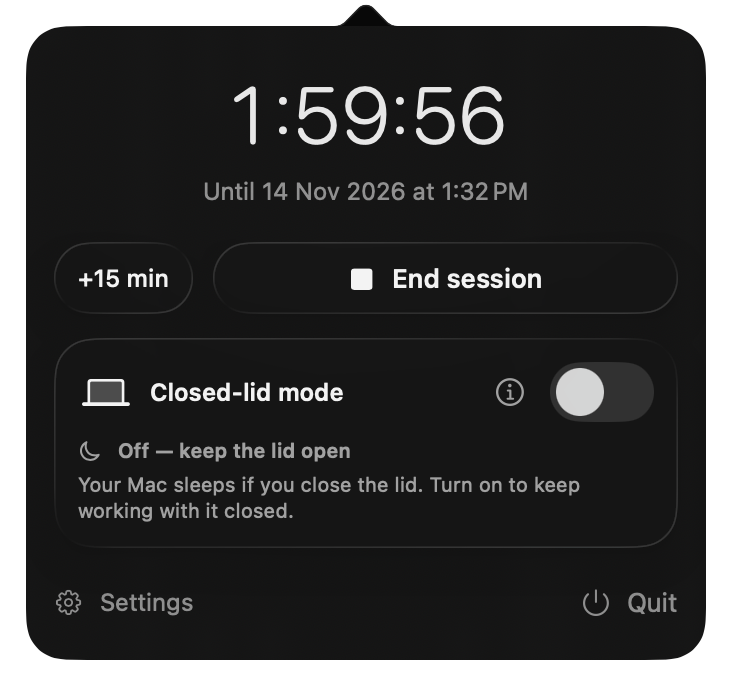

<p align="center">
  
</p>

<h1 align="center">Vigil</h1>

<p align="center">
  Keeps your Mac awake while your agents work, with the lid open <b>or closed</b>,<br>
  and keeps going even if the app quits or crashes.
</p>

<p align="center">
  
  &nbsp;&nbsp;
  
</p>

A menu-bar app for macOS 14+, plus a `vigil` command so scripts and coding agents can keep the machine awake themselves.

## Why

Long agent runs, builds and downloads die when the Mac goes to sleep, and the usual fix (`caffeinate`, or an awake app) stops working the moment the lid closes or the app goes away. Vigil hands the session to a small background helper, so it:

- **survives the app.** Quit, crash or force-quit Vigil, and the session carries on until its end time.
- **works with the lid closed.** Start a session, wait for *Ready to close the lid*, and close it.
- **always cleans up.** Every limit, stop, crash and reboot path puts your Mac's sleep setting back.

## Features

- **Timer, until a time, or unlimited.** Presets from 5 min to 4 hours, and *+15 min* to extend a running session.
- **Closed-lid mode** with its own battery budget and an optional time limit.
- **Safety limits, enforced by the helper rather than the app:** end time, require power adapter, stop at a battery level, and turn off closed-lid mode if the Mac runs hot.
- **`vigil` CLI** for terminals, scripts and agent hooks.

## Install and use

1. Build the app (see [Build](#build)) or open the DMG, then move Vigil to Applications.
2. Click the eye icon in the menu bar → **Closed-lid mode → Set up…** and enter your Mac password once. This installs the helper.
3. Pick a duration and **Start session**.

From a terminal or an agent hook:

```sh
vigil start 2h --closed-lid     # also: 45m, 1h30m, until 18:30, forever
vigil status
vigil extend 30
vigil closed-lid off
vigil stop
```

The DMG isn't notarized, so the first launch needs **System Settings → Privacy & Security → Open Anyway** (or `xattr -dr com.apple.quarantine /Applications/Vigil.app`).

## How it works

```
 Vigil.app (menu bar UI) ─┐
                          ├─ JSON over /var/run/app.vigil.helper.sock ─▶ VigilHelper (root, launchd)
 vigil (CLI, agents)  ────┘                                               • owns the session
                                                                          • idle-sleep assertion
                                                                          • pmset disablesleep (closed lid)
                                                                          • battery / heat / time limits, every 1 s
                                                                          • state + recovery journal on disk
```

- **The helper owns the session.** launchd restarts it if it dies, and it reloads the session from disk.
- **Closed-lid mode** uses `pmset disablesleep`. The original value is written to a journal on disk *before* it is changed, and is always restored: on stop, on any limit, on helper shutdown, and at boot. Sessions never survive a restart.
- **No Developer ID needed.** The helper is installed once with an administrator password (`script/helper.sh`). Until then, the start button reads **Set up & start**.

## Build

Requires Xcode 26: Swift 6, and the macOS 26 SDK for the Liquid Glass controls. The app runs on macOS 14+.

```sh
script/build.sh               # build dist/Vigil.app and open it
script/build.sh --build-only
swift test                    # includes helper crash/recovery cases
script/make_dmg.sh            # dist/Vigil-<version>.dmg (release, universal)
```

## Project layout

| Path | What |
| --- | --- |
| `Apps/Vigil` | Menu-bar app shell: popover, settings tabs, feature registry |
| `Apps/VigilHelper` | Root daemon: session owner, safety loop, sleep setting, socket server |
| `Apps/VigilCLI` | `vigil` command |
| `Sources/VigilKit` | `FeatureModule` contract shared by all features |
| `Sources/VigilIPC` | Request/response types, socket framing, paths |
| `Sources/DesignSystem` | Shared SwiftUI components (glass surfaces, settings sections) |
| `Sources/Features/Awake/AwakeCore` | Session rules and policies: pure, no UI, fully tested |
| `Sources/Features/Awake/AwakeUI` | Awake feature: model, views, helper client and installer |
| `script/` | Build, DMG, icon, root install script |
| `docs/` | [How to add a feature](docs/ADDING_A_FEATURE.md) |

## Security model

Any local process can talk to the helper's socket. The helper accepts only bounded session commands (validated again in the helper) and runs no other commands, so the worst misuse is keeping the Mac awake within the limits. Unlike a Developer-ID-signed helper, it cannot verify *which* app is calling.

## License

MIT. Vigil is derived from the last MIT-licensed revision of [WakeBee](https://github.com/jswladitya/WakeBee) by Aditya Jaiswal. See [NOTICE.md](NOTICE.md) for what came from WakeBee and what is new.
